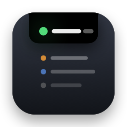

<p align="center">
  
</p>

<h1 align="center">Notchling</h1>

<p align="center"><b>Know which Claude Code session needs you, right from the notch.</b></p>

Notchling lives in your MacBook's notch, or in a small black pill at the top of any other display. It tells you which Claude Code session finished or needs you, and takes you straight to it. Its heap collects text, links, files and screenshots from any app, so you can paste them into Claude in one go.

This repo holds the downloads and the Homebrew cask. The source is private for now.

## Requirements

- macOS 14 Sonoma or later
- Apple silicon or Intel

## Install with Homebrew

```sh
brew tap fanoflix/notchling https://github.com/Fanoflix/notchling-releases
brew trust fanoflix/notchling
brew install --cask notchling
```

`brew trust` is needed on Homebrew 7 and later, which refuses casks from third-party taps until you trust them. On older versions, skip it.

Homebrew also clears macOS's download warning for you, so Notchling opens straight away.

## Install from the DMG

1. Download `Notchling-x.y.z.dmg` from the [latest release](https://github.com/Fanoflix/notchling-releases/releases/latest).
2. Open it and drag **Notchling** into **Applications**.
3. Open Notchling from Applications.

Notchling isn't signed by Apple yet, so the first time you open it macOS says it "can't be opened" or "is damaged". Fix it once, in either of these ways:

- **System Settings:** open **System Settings → Privacy & Security**, scroll down to the message about Notchling and click **Open Anyway**. Then open Notchling again and click **Open**.
- **Terminal:** run this, then open Notchling again:

  ```sh
  xattr -dr com.apple.quarantine /Applications/Notchling.app
  ```

On macOS 15 and later, Control-clicking the app and choosing **Open** no longer gets past this message. Use one of the two ways above.

## First run

1. Click **Connect** in the welcome window. Notchling adds small hooks to `~/.claude/settings.json` and saves a backup next to it first.
2. The first time you grab something (⌥⌘H), macOS asks for **Accessibility** and **Screen Recording** access. Notchling uses them to read your selection and take the snapshot the tendrils lift. Turn both on in **System Settings → Privacy & Security**.

If you reinstall or update from the DMG, macOS can forget those permissions. Remove Notchling from both lists and add it again.

## Updates

Notchling checks this repo for new releases. With Homebrew, run `brew upgrade --cask notchling`.

## Report a problem

Open an [issue](https://github.com/Fanoflix/notchling-releases/issues) with your macOS version and what you did right before it went wrong.

## Uninstall

1. In **Settings → Claude Code**, click **Disconnect**. This removes only Notchling's hooks.
2. Quit Notchling and delete it, or run `brew uninstall --zap --cask notchling`. The `--zap` flag also disconnects the hooks and deletes `~/.notchling`.
